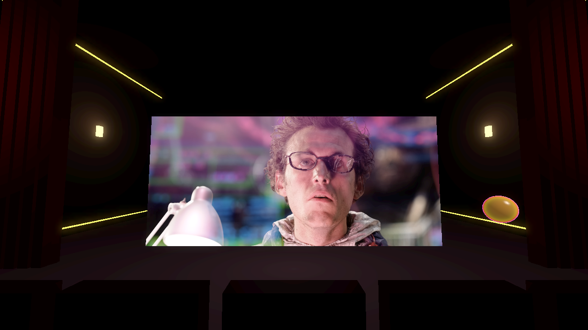
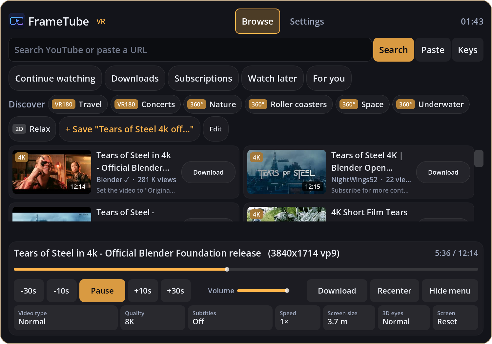

<p align="center"></p>

# FrameTube

Watch YouTube and YouTube VR videos (360°, 180°, 3D) in your Steam Frame, or on a big virtual screen.
Free and open source ([MIT](LICENSE)).

> FrameTube is an independent project, not affiliated with or endorsed by YouTube, Google or Valve.

<p align="center">
  
  
</p>

## Features

- **360°, 180° (VR180) and 3D** detected automatically: up to 8K on a PC, 4K on the Frame by itself.
- **A big screen** for regular videos, in a room of your choice. Grab, move, resize and curve it.
- **Search, Discover topics, Continue watching**, plus Subscriptions and Watch later when signed in.
- **Downloads** for offline viewing, and **sending videos between your PC and Frame** over Wi-Fi.
- **Subtitles, playback speed, resume** and play next.
- **Family-friendly filter** (on by default) and a **parental PIN**.
- **No setup**: downloads its helpers (yt-dlp, FFmpeg, Deno) on first run and keeps them updated.

## Install

1. Download the zip for your device from the [releases page](../../releases):
   - **Windows**: run on your PC and stream to the Frame (smoothest, up to 8K).
   - **SteamFrame**: runs on the headset itself, no PC needed.
   - **Linux**: for Linux PCs (x86_64).
2. Unzip and follow "How to install.txt" inside
   ([Windows](docs/install-windows.txt), [Steam Frame](docs/install-steamframe.txt)).
3. On first run FrameTube downloads its helpers (about 300 MB, once). Then search or tap a **Discover** topic.

## Controls

| Input | Action |
|---|---|
| Trigger at the menu | click |
| Thumbstick up/down on the menu | scroll |
| Thumbstick left/right (pointing at nothing) | seek ∓10 s |
| A / X | play / pause |
| B / Y or Menu | show / hide the menu |
| Thumbstick click | recenter |
| Grip on the screen or menu | move it (both hands: resize) |
| Grip on the toy | grab and throw it |

Desktop mode (no headset): click the menu, right-drag to look around. `Space` pause, `←/→` seek,
`H` show/hide the menu, `P` change video type, `R` recenter.

## Sending videos between devices

With FrameTube open on both the PC and the Frame on the same network, they find each other automatically.

- **Settings > Save downloads to > Steam Frame**: the PC downloads (faster) and moves the video to the Frame.
- **Downloads > Send to Frame / Send to PC** sends a copy.
- The first time, the receiving device asks **"Allow videos from …?"**. Turn receiving off in Settings.

Discovery uses UDP port 47811 and transfers use TCP port 47812. Each allowed device has its own secret, and
the receiver only accepts video and subtitle files for real YouTube IDs, if there's room. See `scripts/link.gd`.

## Signing in (optional)

**Settings > YouTube account** opens a fresh, throwaway browser profile (Firefox, Chrome, Edge or Brave) at
Google's sign-in page. Once you're signed in, FrameTube copies the login to its own `cookies.txt` and deletes
the profile. This unlocks subscriptions, Watch later and age-restricted videos.

## How it works

```
search / URL ─► yt-dlp ─► stream URLs ─► ffmpeg (GPU decode) ─► raw frames ─► Godot textures ─► shader
                                         ffmpeg (audio)      ─► PCM        ─► audio stream (master clock)
```

Plain GDScript on Godot 4.7 with OpenXR, with no GDExtensions, so the same project runs on Windows and on the
Frame's ARM64 Linux. The shader handles flat, equirectangular, YouTube's cubemap (EAC) and stereo layouts.
Videos are identified from stream metadata first and the title second. If one looks wrong, change its
**Video type**, or swap **3D eyes**.

## Development

- **Run**: open the project in Godot 4.7 and press F5. It starts in VR if SteamVR is running, otherwise in
  desktop mode.
- **Helpers**: installed to the app's data folder by `scripts/setup.gd` (SHA-256 checked). Copies in `bin/`
  take priority (git-ignored).
- **Release zips**: `python tools/build_release.py [path\to\godotconsole.exe]` writes `build/release/*.zip`.
- **Test hooks** (after `--`): `--play=<url> [--shots=<dir>]` logs playback stats and saves screenshots.
  `--ui-test`, `--topics-test`, `--langs-test`, `--rig-test`, `--pin-test`, `--search=<q> --scroll-test=N` and
  `--link-test` check individual features. Tests don't touch your settings unless you pass `--persist`.

## Known limitations

- 8K at 60 fps tops out around 30 fps, so Auto quality picks 5.7K or 4K for those videos.
- 3D (stereo) cubemap 360° videos aren't supported yet.
- On the Frame, controller buttons use SteamVR's default bindings. Remap them there if needed.

## License & credits

[MIT License](LICENSE). Built with [Godot Engine](https://godotengine.org). On first run FrameTube downloads
[yt-dlp](https://github.com/yt-dlp/yt-dlp), [FFmpeg](https://github.com/BtbN/FFmpeg-Builds) and
[Deno](https://deno.com) from their official releases. They aren't included here
(see [THIRD_PARTY_NOTICES.md](THIRD_PARTY_NOTICES.md)).

**Disclaimer.** FrameTube doesn't host or distribute videos. Videos are streamed from YouTube and belong to
their creators. Using a third-party YouTube client may go against YouTube's terms of service. Download only for
your own offline viewing. Provided "as is", without warranty.

Screenshots show *Tears of Steel* by the [Blender Foundation](https://mango.blender.org) (CC BY 3.0).
